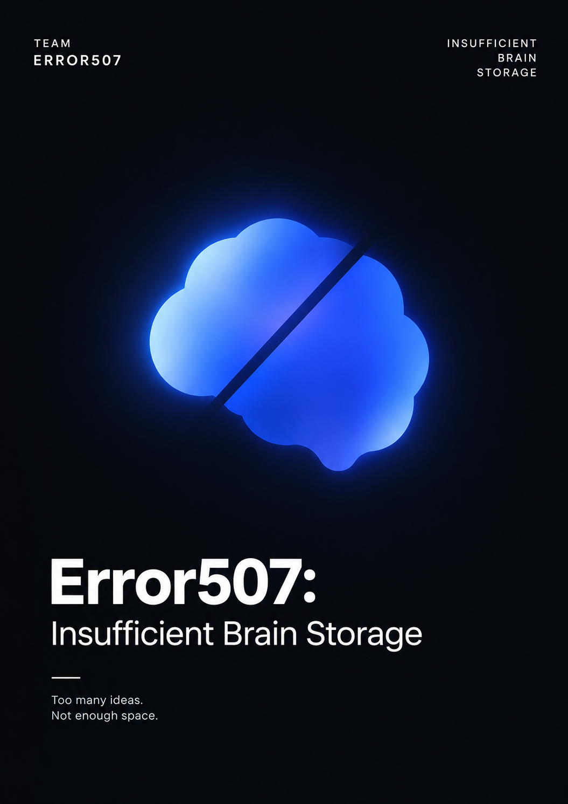
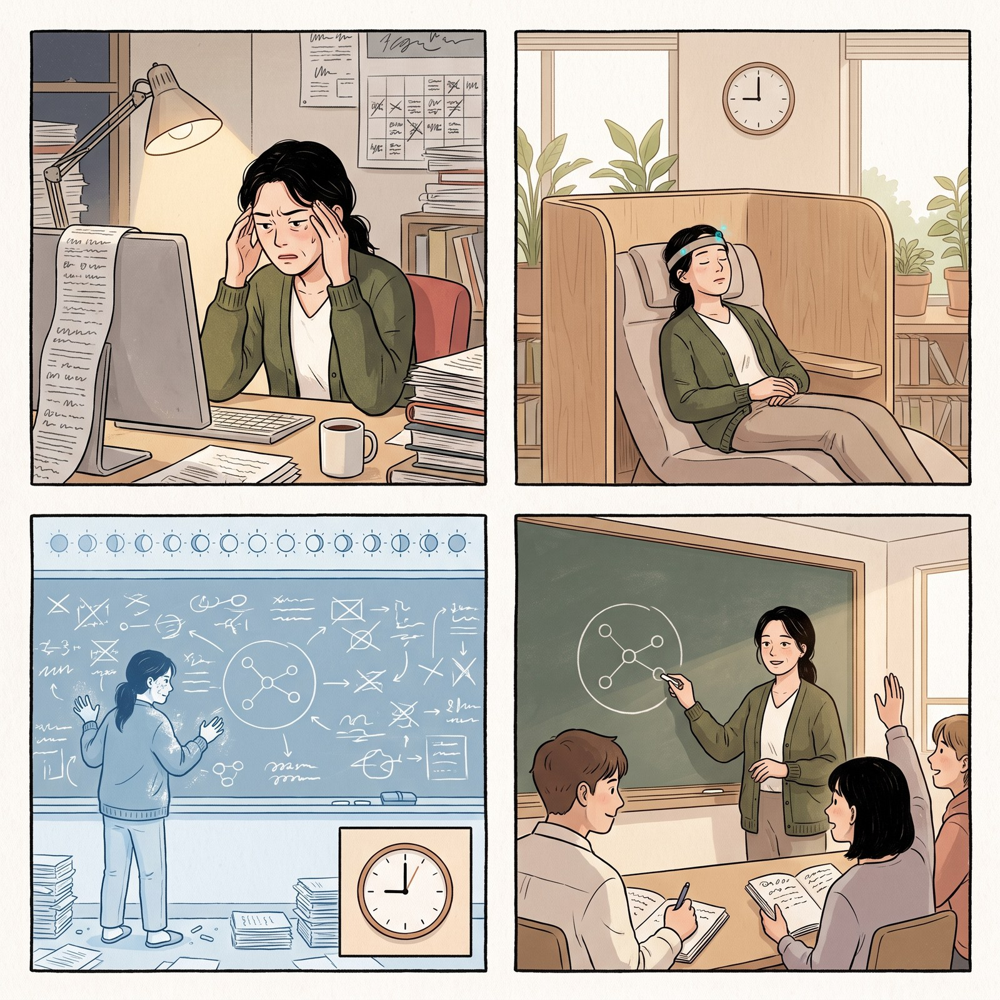

# Welcome to E26-AI01-07

## 🎯 팀 슬로건

> Error507: Insufficient Brain Storage

## 🖼️ 팀 포스터

***

## 1️⃣ 팀원 소개

| **이름**  | **전공** | **관심사**                   |
| ------- | ------ | ------------------------- |
| **서재민** | 인공지능전공 | 인공지능, 웹, 창업, 로봇, 돈        |
| **송채원** | 인공지능전공 | 인공지능, 보안, 암호              |
| **윤서후** | 인공지능전공 | 인공지능,게임,창업,기타             |
| **하준서** | 인공지능전공 | 인공지능, 디지털 헬스케어, 의료 데이터 분석 |

### 팀 소개

팀의 소개를 작성합니다.

***

## 2️⃣ 공통된 관심사 : 여행, 백엔드, 인공지능

***

## 3️⃣ 한학기 동안의 활동 내역

- 기관/부서 인터뷰 ✔️  

- 현장 탐방 ✔️  

- 멘토링 ✔️  
  - 내 지도 교수 함게 만나기
  - 대학원 방문 및 선배 만나기

- 프로젝트 진행 ✔️  
  - 과거에 사람들이 상상한 미래
  - 그들이 만들어가는 세상
  - 우리가 상상한 미래
  - 우리가 그리는 미래 그리고 나

- 각오와 소감 나누기 ✔️  

## 날짜별 활동 내역

<strong>📅 9월 18일</strong>

### 🟦 미션 1 — 이정문 화백이 예측한 미래와 현재 이루어진 것 4분류 및 근거 작성

#### 1. 실현됨

- **전기 자동차** — 전기차가 양산되어 실제 교통수단으로 널리 사용됨
- **태양광 발전 주택** — 주택용 태양광 발전 시스템이 상용화됨
- **소형 TV·전화기 — 스마트폰이 통화와 영상 시청 기능을 통합함**
- **전파 신문** — 스마트폰·태블릿을 통해 무선으로 실시간 뉴스를 이용할 수 있음
- **원격 학습** — 인터넷 강의와 화상 수업 등이 일반적으로 활용됨

#### 2. 일부 실현

- **스마트 부엌** — IoT 가전은 상용화됐지만 부엌 전체의 완전 자동화에는 한계가 있음
- **자율주행 자동차** — 제한된 환경에서 구현됐지만 완전자율주행의 일반 상용화에는 기술·안전·법·보험 등의 한계가 있음
- **원격 진료** — 실제 활용되고 있으나 직접 진찰의 한계와 제도·적용 범위의 제한이 존재함

#### 3. 아직 미실현

- **달나라 수학여행** — 달 여행이 일반인을 위한 관광·교육 수단으로 상용화되지 않았으며 비용·안전·기술적 장벽이 큼

#### 4. 방향 전환

- **움직이는 도로** — 도시 전체의 움직이는 도로 대신 공항·역 등의 무빙워크 형태로 유사한 기능이 구현됨

### 🟦 미션 2 — Why-What-How 심층 분석: 소형 TV·전화기

#### WHY

당시에는 정보를 얻거나 지인과 연락하기 위해 특정 장소에 있는 통신·영상 기기에 직접 가야 했기 때문에, 도구를 이용하는 것이 아니라 오히려 **도구에 자신의 행동이 제약된다는 불편함**을 느꼈을 것으로 보인다. 이러한 제약에서 벗어나 **언제 어디서든 필요한 정보를 얻고 사람들과 소통하고자 하는 욕구**가 **소형 TV와 전화기**에 대한 상상으로 이어졌다고 볼 수 있다.

#### WHAT

**정보와 소통의 공간적 제약이 사라진 모습**을 떠올렸을 것으로 보인다. 장소에 관계없이 **뉴스를 접하고, 원하는 TV 프로그램을 시청하며, 지인들과 연락할 수 있는 일상**을 기대한 것이다. 이러한 바람은 **작고 휴대할 수 있는 TV와 전화기**라는 구체적인 모습으로 나타났다.

#### HOW

오늘날 그 상상은 단순히 소형화된 TV와 전화기를 넘어, **스마트폰이라는 하나의 기기에 뉴스·영상·통신 등 다양한 기능이 통합되는 형태**로 구현되었다. 반도체와 디스플레이, 배터리의 소형화 및 성능 향상과 이동통신·무선 인터넷 기술의 발전이 **하드웨어 기반**을 마련했고, 모바일 운영체제와 애플리케이션, 스트리밍, 메신저 등의 **소프트웨어가 다양한 기능을 하나로 연결**했다. 과거의 상상에서는 소형 TV와 전화기가 각각 독립된 기기로 제시되었지만, 현재는 **스마트폰 한 대가 두 기기의 역할은 물론 정보 검색과 콘텐츠 제작·공유까지 수행**한다. 스마트폰은 이제 단순한 통신 도구를 넘어 일상생활에 필수적인 기기로 자리 잡았다.

#### NEXT

하지만 이러한 기술의 발전은 새로운 문제를 만들어냈다. 도구의 제약에서 벗어나기 위해 상상했던 스마트폰이 오히려 현대인에게 **또 다른 형태의 제약**이 된 것이다. **스마트폰에 지나치게 의존하거나 사용을 스스로 통제하기 어려운 문제**가 나타났으며, 개인정보 유출과 보안 위협, 알고리즘에 의한 정보 편향, 허위 정보의 확산, 디지털 격차도 새로운 **사회적·윤리적 과제**로 떠올랐다. 기술적으로도 **배터리 사용 시간과 재난 상황에서의 안정적인 연결성** 등 개선할 부분이 남아 있다. 앞으로는 스마트폰과 어떻게 공존하고 적절하게 사용할 것인지뿐만 아니라, 기술의 편리함과 **사용자의 권리·안전**을 어떻게 조화시킬 것인지도 함께 고민해야 한다.

<strong>📅 10월 2일</strong>

### 🟦 미션 1 — AI와 함께 문제 다시 쓰기

팀원이 대학생활에서 겪은 불편함을 각각 한 문장으로 적고, AI에게 "이 상황의 핵심 문제와 사용자 요구사항을 추상화해서 사용자, 상황, 문제, 기대 변화로 다시 정의해줘"라고 요청해 문제 정의문으로 바꿨다.

#### 문제 A. 포털 정보가 개인 일정에 반영되지 않는 문제

- **Before**: 학교 온라인 포털에 과제와 공지가 과목별로 흩어져 있어 직접 들어가 확인해야 하고, 마감일이 내 캘린더에 반영되지 않아 과제를 놓치기 쉽다.
- **After**: 수강생이 여러 과목의 과제와 공지를 확인할 때, 정보가 과목별 화면에 분산되어 있고 개인 일정과 연동되지 않아 마감을 놓치는 문제.
- 사용자는 한 학기에 6개 이상의 과목을 듣는 학생이고, 기대하는 변화는 마감일이 자동으로 일정에 들어와 포털을 매번 열지 않아도 되는 것이다.

#### 문제 B. 팀 프로젝트에서 모두가 비는 시간을 찾기 어려운 문제

- **Before**: 팀원 4명이 각자 시간표 캡처를 카카오톡에 올리고, 겹치는 공강을 눈으로 비교해서 찾는다.
- **After**: 팀 프로젝트 팀원이 회의 시간을 정할 때, 서로 다른 시간표를 수작업으로 대조해야 해서 시간이 오래 걸리고 겹치는 시간을 놓치는 문제.
- 기대하는 변화는 시간표를 입력하면 모든 팀원이 비는 시간대가 바로 나오는 것이다.

#### 문제 C. 학교 알림에 불필요한 정보가 많은 문제

- **Before**: 학교에서 오는 공지가 전체 학생 대상으로 발송되어, 내 학년·학과·관심사와 관계없는 알림이 많고 필요한 공지를 찾기 어렵다.
- **After**: 학생이 학교 공지를 확인할 때, 대상과 분야가 구분되지 않은 알림이 한꺼번에 오기 때문에 필요한 정보를 가려내는 데 시간이 들고 중요한 공지를 놓치는 문제.
- 기대하는 변화는 내 학과, 학년, 관심 분야에 해당하는 공지만 보는 것이다.

### 🟦 미션 2 — AI 아이디어 비교 및 선택

미션 1의 세 문제를 AI에게 각각 설명하고 해결 방향을 제안받은 뒤, 팀 기준으로 다시 평가했다.

| 평가 기준 | A. 포털 일정 통합 (선택) | B. 팀 공강 자동 계산 | C. 공지 맞춤 필터 |
| --- | --- | --- | --- |
| 필요성 (Why) | 과제를 놓치면 성적에 바로 영향이 있어 필요성이 크다 | 학기 내내 반복되지만 놓쳐도 손해가 크지 않다 | 매일 겪지만 직접적인 손해는 작다 |
| 새로움 (Novelty) | 시간표 앱과 캘린더 앱은 있으나 포털 과제와 연동한 서비스는 드물다 | 일정 조율 서비스가 이미 있다 | 키워드 필터는 일반적이다 |
| 실현 가능성 (How) | 포털의 공개 API 여부가 불명확하다. 복사·붙여넣기 입력이나 캘린더 파일(.ics) 내보내기로 시작할 수 있다 | 시간 구간의 교집합 계산이라 구현이 단순하다 | 규칙 기반 분류는 쉽지만 LLM 분류는 정확도 검증이 필요하다 |
| 위험 요소 (Risk) | 포털 계정 정보를 다루면 보안 문제가 생기고 약관 위반 가능성이 있다 | 시간표 공개에 대한 팀원 동의가 필요하다 | 중요한 공지가 필터에 걸러져 누락될 수 있다 |

#### AI의 반론과 팀의 수정

A에 대해 "작동하지 않거나 사용자가 외면할 이유 3가지"를 AI에게 요청했다.

1. 학교 포털이 외부 서비스 연동을 막아 두었을 수 있다.
2. 포털 로그인 정보를 맡기는 데 학생이 거부감을 느낀다.
3. 이미 쓰는 캘린더와 알림 앱이 있어서 새 서비스로 옮길 동기가 약하다.

1번과 2번에 대해서는 로그인 정보를 저장하지 않고, 사용자가 포털 내용을 직접 붙여 넣으면 마감일을 추출해 캘린더에 넣는 방식으로 시작하기로 했다. 3번은 새 앱을 만들지 않고 사용자가 쓰는 기존 캘린더에 일정을 넣는 방식으로 대응한다.

#### 최종 선택: A

- 과제 누락은 성적과 직접 연결되어 세 문제 중 피해가 가장 크다.
- C의 필터링은 A에서 "내 과목의 공지만 표시"하는 기능으로 포함할 수 있다.
- B는 구현이 가장 쉬워 이후 확장 기능으로 남긴다.
- 외부 포털 연동의 위험은 로그인 정보를 다루지 않는 입력 방식으로 낮춘다.

#### 사람이 결정한 부분과 AI가 도운 부분

- 사람이 결정한 부분: 불편함의 선정, 평가 기준, 최종 선택과 근거, AI 반론의 반영 방식
- AI가 도운 부분: 문제 정의문의 구조화, 해결 방향 초안, 실패 시나리오 제시

#### 다음 질문

붙여넣은 포털 텍스트에서 마감일과 과목명을 어느 정도 정확도로 추출할 수 있는가?

<strong>📅 10월 16일</strong>

### 🟦 기획 의도 — 생각하는 사람, 호모 사피엔스

인류의 학명 **호모 사피엔스**(Homo sapiens)는 라틴어로 '사람'(homo)과 '슬기로운, 분별하는'(sapiens)을 합친 말이다. sapiens는 '맛보다, 분별하다, 알다'를 뜻하는 동사 sapere에서 왔다. 인류는 스스로를 다른 동물과 구별하는 이름으로 힘이나 빠르기가 아니라 **생각하고 분별하는 능력**을 골랐다. 우리 팀은 인간에게 가장 중요하고 가치 있는 것이 생각이라고 보았고, 이번 아이디어는 **그 생각을 키우는 공간**에서 출발했다.

AI 발전의 가장 큰 목적은 결국 인간의 발전이다. 그런데 AI와 인간의 가장 큰 차이는 **생각의 속도**다. AI가 내놓는 결과를 따라가고 이해하려면 인간도 함께 발전해야 한다. 정답을 받기만 해서는 그 결과를 이해할 수 없다. 그래서 인간의 생각을 키울 수 있는 공간이 필요하다고 생각했다.

이 문제의식은 2026년 가을 수학계의 반응과도 맞닿아 있다.

- **필즈상 수상자들의 공동 선언** 「A Severe Misalignment of AI in Mathematics」(2026년 9월 11일)은 AI 기업이 수학 문제 풀이를 성능 경쟁의 지표로 삼는 흐름을 비판하며, 문제 풀이는 개념적 이해와 통찰이라는 근본 목표를 위한 도구일 뿐이라고 했다.
- **인간수학협회**(Association for Human Mathematics, AHM)는 OpenAI가 수학 난제 풀이를 담은 원고 700여 편을 한꺼번에 공개하자(10월 6일), 다음 날 성명을 내고 "인간의 이해를 중심에 두는 과학"으로 돌아가자고 촉구했다.

정답을 내는 속도는 AI가 앞서더라도, 그 의미를 이해하는 것은 사람의 몫이라는 뜻으로 읽었다. 수학계는 AI를 다루는 방식에 문제를 제기했고, 우리 팀은 **사람의 생각을 키우는 쪽**에서 답을 찾아보기로 했다.

### 🟦 미래 상황 설정 — 2045년, 우리는 어떻게 살고 있을까

"AI가 엄청 발전한다면?"이라는 질문에서 출발했다. 처음에는 AI와 자동화를 긍정적으로만 그렸지만, 논의를 거치며 아래 가정을 세웠다.

1. **AI 피로**: 지금도 AI를 써 보지 않아서가 아니라 너무 많이 써서 무료함을 느끼는 사람이 있다. 2030년대에는 이것이 사회 현상이 된다.
2. **그래도 AI는 줄지 않는다**: 피로는 AI를 쓸지 말지가 아니라 어디서 어떻게 쓸지를 바꾼다. AI는 눈에 보이지 않는 기반이 되고, 개발 분야에서 이미 시작된 것처럼 AI가 만든 결과를 AI가 검토하고 승인한다.
3. **사람이 직접 한 것이 귀해진다**: 기계 생산 뒤에 미술공예운동이, 패스트푸드 뒤에 슬로푸드가 나왔다. 기술이 흔해질수록 사람이 직접 한 것의 가치가 커진다.
4. **생각하지 않는 사람들**: AI는 1초 만에 답하지만 직접 생각하면 몇 시간이 걸린다. 사람들이 생각하지 않는 것은 게을러서가 아니라 **생각의 비용, 즉 시간이 너무 비싸기 때문**이다. 답을 얻어도 내가 생각한 것이 아니라 공허하고, 생각하는 능력은 점점 줄어든다.

> **팀의 가설**: 2045년, 생각하는 데 드는 시간을 줄여 주면 사람은 다시 스스로 생각한다.

경제 구조의 변화도 논의했지만 답을 내기 어렵다고 판단해, 이번 기획은 기술과 생활의 변화에 집중했다.

### 🟦 미션 1 — 미래 장면과 문제 선택

#### 후보 비교

| 평가 기준 | A. 생각 가속 공간 (선택) | B. AI가 대신하는 대화 | C. 에이전트 블랙박스 |
| --- | --- | --- | --- |
| 내용 | 내 뇌를 가상 공간에 복제해 빠르게 생각하고, 그 기억을 가지고 돌아온다 | 내 말투를 배운 AI가 메시지를 대신 쓰고, 상대 AI가 읽고 요약한다 | 내 이름으로 일하는 AI 에이전트의 행동을 기록하고 검증한다 |
| 사용자 가치 | 잃어 가는 생각하는 능력과 "내가 했다"는 성취감을 되찾는다 | 메시지 부담은 줄지만 관계가 비어 간다 | 내 이름으로 일어난 일을 알 수 있다 |
| 아이디어의 새로움 | 정답의 품질이 아니라 '내 생각'이라는 점으로 AI와 겨룬다 | 지금의 자동 답장 기능의 연장에 가깝다 | 문제는 새롭지만 해결 방식은 익숙한 감사 도구다 |
| 문제 정의의 근거 | 팀원 모두 AI의 답을 설명하지 못한 경험이 있고, 2026년 수학계도 AI의 결과를 사람이 이해하지 못하는 문제를 제기했다 | 팀원 경험 일부 | 미래 가정이 많아 근거가 약하다 |
| 향후 확장성 | 연구자, 바쁜 직장인, 마음이 힘든 사람에서 AI와 함께 사는 모든 사람으로 넓힐 수 있다 | 메신저 기능에 머문다 | 기업용 감사로 넓힐 수 있다 |

**최종 선정: A.** 팀의 가설과 직접 이어지고, 네 기준 모두에서 앞섰다.

A는 논의 중에 두 번 바뀌었다.

- 처음에는 **나를 복제한 AI와 대화**하는 방식을 생각했다. 하지만 대화 상대는 결국 또 하나의 AI가 될 뿐이라고 보고, **내 생각 자체를 가속하는 공간**으로 바꿨다.
- 생각의 결과(정리 노트)만 가져오면 AI가 준 정답과 다를 것이 없다. 그래서 **생각한 과정의 기억을 그대로 가져오는 것**을 핵심으로 정했다. 다른 세계에 다녀와도 그때의 기억이 남는 것과 같다.

#### 미래 문제 문장

| 구분 | 내용 |
| --- | --- |
| 누가 | 혼자 깊이 생각할 시간이 꼭 필요하지만 그 시간을 낼 수 없는 2045년의 사람들(바쁜 사람, 진리를 탐구하는 사람, 마음이 힘든 사람)이 |
| 언제·어디서 | 스스로 답을 찾아야 하는 문제나 고민을 만났을 때 |
| 무엇이 불편한가 | 깊이 생각하려면 며칠이 필요하지만 그 시간을 낼 수 없다. AI는 1초면 답하지만 그 답은 내 생각이 아니라 이해되지도, 와닿지도 않는다 |
| 왜 중요한가 | 생각하지 않는 사이에 생각하는 능력이 줄고, AI의 결과를 이해하지 못한 채 받아들이게 된다 |
| 어떤 변화가 필요한가 | 짧은 시간 안에 내 뇌로 충분히 생각하고, 그 과정까지 내 것으로 가져오는 공간이 필요하다 |

#### 팀 역할 분담

| 팀원 | 역할 | 주요 활동 |
| --- | --- | --- |
| 서재민 | 퍼실리테이터 | 미래 가설 논의 진행, 아이디어 전환 과정 정리 |
| 송채원 | 사용자 관찰자 | 사용자 입장에서 불편 검증, 생각 기록의 보안 위험 점검 |
| 하준서 | 기록자 | 논의 근거 기록, 뇌 신호와 사고력 관련 자료 조사 |
| 윤서후 | 시각화 담당 | 4컷 장면 구성과 이미지 프롬프트 작성 |

### 🟦 미션 2 — 미래 서비스 캔버스와 시각화

#### 서비스 콘셉트

- **이름**: 생각의 방 (Think Room)
- **한 줄 설명**: 1시간 접속으로 몇 주 치 생각을 하고, 그 생각의 기억을 그대로 가지고 돌아오는 생각 가속 공간
- **핵심 사용자**: 혼자 생각할 독립적인 시간이 꼭 필요하지만, 그 시간을 낼 수 없는 사람

| 페르소나 | 상황 | 필요한 것 |
| --- | --- | --- |
| **진리를 탐구하는 사람** 수학자 서윤(39), 대표 장면 | AI가 밤사이 난제의 증명을 내놓았다. 결과는 맞다고 확인됐지만 왜 맞는지 설명할 수 있는 사람이 없다. 강의와 행정에 쫓겨 몇 주씩 매달릴 시간이 없다 | AI의 결과를 내 힘으로 이해하는 시간 |
| **진짜 바쁜 사람** 스타트업 대표 도현(44) | 하루 수십 건의 결정을 AI 추천으로 처리한다. 회사의 방향처럼 정말 중요한 결정은 직접 고민하고 싶지만 그럴 시간이 없다 | 큰 결정을 앞두고 혼자 오래 생각할 시간 |
| **마음이 힘든 사람** 가족을 잃은 회사원 하은(31) | AI 상담은 위로의 말을 바로 건네지만 마음에 닿지 않는다. 일상에 쫓겨 자기 마음을 정리할 시간이 없다 | 남의 말이 아니라 스스로 마음을 정리하는 시간 |

| 핵심 기능 | 내용 |
| --- | --- |
| 1. 생각 가속 | 뇌를 가상 공간에 복제해 컴퓨팅 자원 위에서 생각을 돌린다. 1시간 동안 체감 몇 주 치를 생각한다 |
| 2. 기억 귀환 | 가상 공간에서 생각한 과정이 결론과 함께 내 기억으로 돌아온다 |
| 3. 생각 기록과 복기 | 생각한 과정이 텍스트와 영상으로 남는다. 바둑의 복기처럼 다시 보며 어디서 막혔는지 찾고, 그 지점부터 이어서 생각할 수 있다 |

| 사용 전 | 사용 후 |
| --- | --- |
| AI가 준 답을 받아 들지만, 왜 그런지 이해하지 못한 채 넘어간다 | 1시간 접속해 몇 주 치를 직접 생각하고, 돌아와서 내 말로 설명한다 |
| 생각하려 해도 시간이 없어 포기한다 | 생각을 건너뛸 이유가 사라진다. 기록을 복기하며 생각하는 습관을 고친다 |

**작동 장면**: 2045년 어느 날 아침 9시, 수학자 서윤은 출근 전에 생각의 방에 1시간 동안 접속한다. 전날 밤 AI가 내놓은 증명은 맞다고 확인됐지만, 왜 맞는지는 아무도 설명하지 못했다. 가상 공간 속의 서윤은 3주 동안 그 증명을 한 줄씩 직접 따라가며 씨름한다. 돌아오면 그 3주의 기억이 남아 있다. 그날 오후 서윤은 학생들에게 증명의 핵심 아이디어를 자기 말로 설명한다. 저녁에는 기록을 다시 열어, 둘째 주에 한 가정에 갇혀 며칠을 헤맨 장면을 찾아 강의 자료로 정리한다.

#### 미래 서비스 캔버스

| 항목 | 내용 |
| --- | --- |
| 01 사용자 | 혼자 깊이 생각할 시간이 필요하지만 낼 수 없는 사람. 대표 예시는 AI가 내놓은 증명을 이해해야 하는 39세 수학자 |
| 02 상황 | AI가 내놓은 결과나 인생의 큰 고민처럼 스스로 생각해야 할 문제를 만났지만, 일상에 쫓겨 시간이 없을 때 |
| 03 현재의 불편 | AI는 1초면 답하지만 직접 생각하려면 며칠이 걸린다. 생각을 건너뛰게 되고, AI의 답은 이해되지 않고 내 것도 아니다 |
| 04 미래의 변화 | 1시간이면 내 뇌로 몇 주 치 생각을 할 수 있어 생각을 건너뛸 이유가 사라진다 |
| 05 핵심 경험 | 1시간 뒤 눈을 떴을 때 몇 주 동안 씨름한 기억이 남아 있고, "내가 이해했다"고 느끼는 순간 |
| 06 필요 기술 | 뇌 신호 측정과 해독, 뇌 활동을 가상 공간에서 재현하고 가속하는 연산, 기억을 다시 뇌로 전달하는 기술, 생각 기록의 저장과 재생 |
| 07 남은 위험 | 생각 기록의 유출, 몇 주 치 기억이 한 번에 돌아올 때의 정신적 부담, 마음이 힘든 사람에게는 같은 생각을 되풀이하는 반추가 가속될 위험, 이 공간 없이는 생각하지 못하게 되는 새로운 의존 |

#### 미래 장면 시각화

| 컷 | 장면 |
| --- | --- |
| 1 | 밤, 연구실. AI가 내놓은 긴 증명 앞에서 서윤은 이해하지 못한 채 머리를 감싼다. 달력은 일정으로 가득하다 |
| 2 | 아침 9시, 생각의 방. 서윤이 헤드밴드를 쓰고 눈을 감는다 |
| 3 | 가상 공간(파란색). 달이 차고 기우는 몇 주 동안 서윤은 칠판 가득 증명을 직접 따라가며 씨름한다. 오른쪽 아래 현실의 시계는 몇 분밖에 지나지 않았다 |
| 4 | 다시 현실. 서윤은 가상 공간에서 찾은 핵심 도식을 칠판에 다시 그리며 학생들에게 설명한다 |

현실은 따뜻한 색, 가상 공간은 파란색으로 나눠 두 공간을 구분했다. 3컷과 4컷에 같은 도식을 넣어 생각한 과정이 기억으로 돌아왔음을 보여 주었다.

이미지 생성 프롬프트 기록 (Gemini)

수업의 7단계 구조에 맞춰 작성했다. AI가 만든 그림처럼 보이지 않도록 사람이 그린 그래픽노블 화풍, 고르지 않은 선, 종이 질감, 제한된 색을 지정하고, 광택·3D·홀로그램·글자를 제외 요소로 넣었다.

| 단계 | 입력 내용 |
| --- | --- |
| 장면 | 2x2 네 컷 만화, 대사 없음 |
| 사용자 | 39세 한국인 여성 수학자, 느슨하게 묶은 검은 머리, 초록 니트 카디건 (모든 컷에서 같은 인물) |
| 환경 | 늦은 밤 연구실, 나무와 화분이 있는 조용한 2045년 부스, 파란색 생각 공간, 강의실 |
| 행동 | 긴 증명 앞에서 머리를 감쌈 → 눈을 감고 접속 → 칠판 앞에서 씨름 → 학생들에게 설명 |
| 기능 | 얇은 천 헤드밴드, 숫자 없는 아날로그 시계로 시간 압축 표현, 몇 주를 나타내는 달의 위상 변화 |
| 분위기 | 한국 인디 그래픽노블, 손으로 그린 잉크 선, 과슈 느낌의 차분한 색, 종이 질감 |
| 제외 요소 | 글자, 숫자, 수학 기호, 말풍선, 로고, 빛나는 SF 화면, 홀로그램, 3D 광택, 지나치게 매끈한 피부 |

수정 과정: 1차는 대학생을 주인공으로 생성했지만, 핵심 사용자를 바꾸면서 수학자로 다시 생성했다. 2차 결과의 1컷 달력에 영어 요일이 찍혀 있고 오타까지 있어서 그 줄을 지웠다.

#### 벤치마킹

| 항목 | 내용 |
| --- | --- |
| 출처 및 날짜 | 뇌-컴퓨터 인터페이스(BCI) 연구 동향 (2026-10-16 조사) |
| 핵심 요약 | 뇌에 이식한 전극으로 말하려는 문장을 해독해 글자나 음성으로 바꾸는 연구가 진행 중이다 |
| 아이디어 연관성 | 뇌 신호를 읽는 기술은 생각 가속(기능 1)의 출발점이다 |
| 추가 확인 필요 | 지금 기술은 '읽기'의 초기 단계다. 생각 전체의 복제와 가속, 기억을 뇌로 되돌리는 '쓰기'는 2045년 가설의 가장 큰 가정이다 |

| 항목 | 내용 |
| --- | --- |
| 출처 및 날짜 | AI 사용과 사고력에 관한 연구 보도 (2026-10-16 조사) |
| 핵심 요약 | AI로 글을 쓴 사람이 직접 쓴 사람보다 뇌 활동이 낮고, 자기 글을 잘 기억하지 못했다는 연구 결과가 2025년에 발표됐다 |
| 아이디어 연관성 | "AI로 답을 얻으면 생각하는 능력이 줄어든다"는 문제 정의의 근거다 |
| 추가 확인 필요 | 연구 원문과 실험 규모를 확인해야 한다 |

| 항목 | 내용 |
| --- | --- |
| 출처 및 날짜 | 바둑의 복기 (2026-10-16 조사) |
| 핵심 요약 | 바둑 기사들은 대국이 끝나면 처음부터 다시 놓아 보며 잘못된 수를 찾는다 |
| 아이디어 연관성 | 결과가 아니라 과정을 다시 볼 때 실력이 는다는 점이 생각 기록과 복기(기능 3)의 근거다 |
| 추가 확인 필요 | 생각 기록을 다시 보는 것이 실제로 사고력 향상으로 이어지는지 |

#### 실현 가능성 1차 점검

| 평가 영역 | 점검 항목 | 검토 내용 | 판단 |
| --- | --- | --- | --- |
| 기술 | 뇌 신호 읽기 | 연구가 진행 중이지만 생각 전체를 해독하는 수준은 아니다 | 추가 확인 필요 |
| 기술 | 뇌 복제·가속·기억 귀환 | 2045년 가설의 핵심 가정이며 지금은 근거가 없다 | 전문가 확인 권장 |
| 데이터 | 생각 기록 보호 | 결론뿐 아니라 망설임과 편견까지 남는 가장 민감한 데이터다. 본인만 열람하는 원칙이 필요하다 | 추가 확인 필요 |
| 데이터 | 기록 제출 요구 | 학교, 회사, 수사기관이 생각 기록을 요구할 때 어떻게 할 것인가 | 전문가 확인 권장 |
| 안전·윤리 | 정신적 부담 | 몇 주 치 생각이 한 번에 돌아올 때의 피로와 혼란, 마음이 힘든 사용자의 반추 가속 | 전문가 확인 권장 |
| 안전·윤리 | 의존과 격차 | 이 공간 없이는 생각하지 못하게 되는 문제, 이용할 수 있는 사람과 없는 사람의 격차 | 추가 확인 필요 |

#### 멘토에게 물을 질문

1. 뇌 신호 해독 기술은 지금 어디까지 왔고, 뇌에 기억을 '쓰는' 기술은 어떤 근거로 가정할 수 있는가?
2. 생각 기록처럼 민감한 데이터를 다루는 서비스는 어떤 보호 원칙을 갖춰야 하는가?
3. 사람들이 이 공간에도 의존하지 않게 하려면 어떻게 설계해야 하는가?

***

## 4️⃣ 인상 깊은 활동

- 활동명 – 활동에 대한 간단한 설명과 배운 점을 작성  
- 예: 멘토링에서 실리콘밸리 현업 경험을 들을 수 있어 진로 방향 설정에 큰 도움이 되었다.  

***

## 5️⃣ 특별히 알아보고 싶은 것
- 예: 현장실습 제도
- 예: 학부 졸업 인증 조건
- 예: 성취기반평가
- 예: 졸업 후 진로(대학원/취업)

***

## 6️⃣ 활동을 마친 소감

🔗학번 이름  
> "소감 내용을 여기에 작성합니다."

🔗학번 이름  
> "소감 내용을 여기에 작성합니다."

🔗학번 이름  
> "소감 내용을 여기에 작성합니다."

🔗학번 이름  
> "소감 내용을 여기에 작성합니다."

🔗학번 이름  
> "소감 내용을 여기에 작성합니다."

---
### Support or Contact

readme 파일 생성에 추가적인 도움이 필요하면 [도움말](https://help.github.com/articles/about-readmes/) 이나 [contact support](https://github.com/contact) 을 이용하세요.

